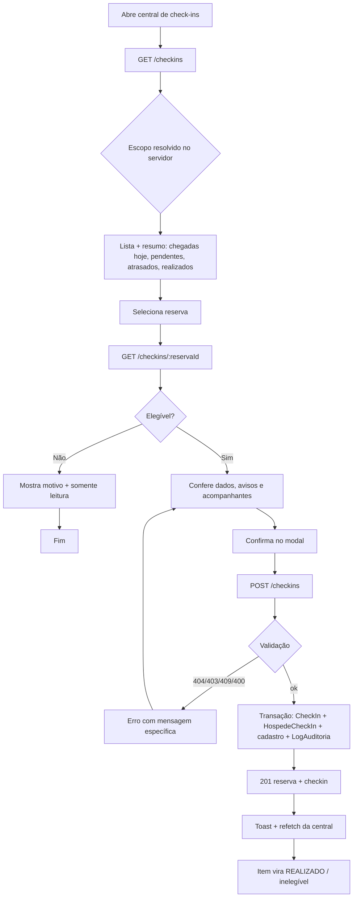

# Fluxo — Check-in no módulo do Estabelecimento

Fluxo operacional do check-in: **central de chegadas → seleção da reserva → conferência (pré-check-in)
→ confirmação → registro + auditoria**. Contrato de API: [`docs/api/checkin.md`](../api/checkin.md).
Plano: [`Implementations/ImplementationPlan_CheckinEstabelecimento_20112026.md`](../../Implementations/ImplementationPlan_CheckinEstabelecimento_20112026.md).
Decisão de modelagem: [`ADR-001`](../adr/ADR-001-checkin-entidade-aditiva.md).

## Atores e pré-condições

| Item | Definição |
|---|---|
| Quem executa | usuário `ESTABELECIMENTO` (dono ou sub-usuário vinculado) ou `ADMIN` |
| Reserva | existe e pertence ao estabelecimento do usuário (checado no servidor) |
| Momento | qualquer dia do período da reserva: antes (antecipado), no dia, ou até o `checkOut` (atrasado) |
| Situação inicial esperada | `CONFIRMADA`, `AGUARDANDO_PAGAMENTO` ou `FINALIZADA` |
| Situação final | `Reserva.status` **não muda**; passa a existir `CheckIn` (+ `HospedeCheckIn`) e um `LogAuditoria` |

## Fluxo em passos

### Passo 1 — Central de chegadas (`/estabelecimento/checkin`)

1. A página abre e chama `GET /api/checkins` (default: `situacao=TODOS`, `page=1`, `limit=20`).
2. O servidor resolve o **escopo do estabelecimento no banco** (dono/sub-usuário/ADMIN) — a query não decide escopo; `estabelecimentoId` alheio → `403`.
3. Cabeçalho mostra os 4 números de `resumo`: **chegadas hoje**, **pendentes**, **atrasados**, **realizados hoje**.
4. Lista mostra, por reserva: código, hóspede, quarto, chegada → saída, chip de situação
   (`PENDENTE`/`ATRASADO`/`REALIZADO`), valor e ação.
5. Filtros disponíveis: `situacao` (aba/segmented), `data` (date picker), `busca` (código/hóspede/quarto), paginação.
   `data` filtra por chegada prevista **ou** check-in realizado naquele dia — é o filtro "chegadas de hoje".
   **Recorte operacional:** `TODOS` e `ATRASADOS` exigem estadia vigente (`checkOut ≥ hoje`); no-show antigo
   não aparece (só no detalhe por URL direta).

**Resultado:** o operador vê a fila do dia e identifica quem ainda não chegou.

### Passo 2 — Seleção

6. O operador clica em uma reserva `PENDENTE`/`ATRASADO` (ou em "Fazer check-in").
7. Itens `REALIZADO` continuam clicáveis (consulta), mas sem ação de check-in; itens inelegíveis mostram
   o texto de bloqueio (`motivoInelegibilidade`) + o código (`codigoInelegibilidade`) e não habilitam a ação.

**Resultado:** a reserva escolhida vira o contexto do pré-check-in (`reservaId`).

### Passo 3 — Conferência / pré-check-in

8. A UI chama `GET /api/checkins/:reservaId`.
9. Exibe: dados da reserva e do quarto, perfil atual do hóspede (`cpf`, `rg`, `dataNascimento`,
   `nacionalidade`), status do pagamento e **avisos**.
10. Avisos são **informativos** e aparecem em ordem fixa: `PAGAMENTO_PENDENTE`, `CADASTRO_INCOMPLETO`,
    `CAPACIDADE_EXCEDIDA`, `CHECKIN_ANTECIPADO`, `CHECKIN_ATRASADO`. Nenhum deles desabilita o botão.
11. O formulário vem pré-preenchido: hóspede principal com o que já existe no cadastro e espaço para
    completar (`cpf`, `rg`/`documento`, `dataNascimento`, `telefone`, `nacionalidade`); acompanhantes
    em lista dinâmica (nome obrigatório, demais opcionais, `presente` ligado por padrão, máx. 20).
12. Se a reserva já tem check-in (`checkin != null`) ou é inelegível (`elegivel = false`), a UI mostra
    somente leitura + motivo; o botão de confirmar não aparece.

**Resultado:** operador confere documento, número de pessoas e pendências antes de registrar.

### Passo 4 — Confirmação

13. Operador clica em **Confirmar check-in**. A UI pede confirmação explícita (modal) resumindo:
    reserva, hóspede principal, quantidade de acompanhantes presentes e avisos pendentes.
14. A UI valida o formulário no cliente (nome do acompanhante obrigatório, datas válidas) — espelho do
    DTO; o servidor continua sendo a autoridade (`400` se algo escapar).
15. Envia `POST /api/checkins` com `reservaId`, `observacoes?`, `hospedePrincipal?`, `acompanhantes?`.
16. Durante o envio: botão em estado de loading, sem duplo submit (proteção de UI + `@unique` no banco).

**Resultado:** requisição única, sem duplicidade.

### Passo 5 — Registro e auditoria (servidor, transacional)

17. Validação em ordem determinística: DTO → reserva existe (`404`) → posse (`403`) → já existe check-in
    (`409`) → status inelegível (`400`) → período encerrado (`400`) → nenhum presente (`400`).
18. Abre `prisma.$transaction`:
    1. cria `CheckIn` (`realizadoEm` = agora, `responsavelId` = usuário autenticado, `observacoes`);
    2. cria `HospedeCheckIn` do **principal** (`principal = true`, `presente = true`);
    3. cria `HospedeCheckIn` de **todos** os acompanhantes informados (`presente` conforme enviado);
    4. atualiza cadastro do hóspede **só com os campos enviados** (`Usuario.telefone`;
       `Hospede.cpf/rg/dataNascimento/nacionalidade`; cria `Hospede` só se vierem `cpf` + `dataNascimento`);
       `documento` vai apenas para `HospedeCheckIn.documento`;
    5. grava `LogAuditoria` (`acao = 'CHECKIN_REALIZADO'`, `entidade = 'Reserva'`, `entidadeId = reservaId`,
       `usuarioId` = autenticado, `dadosNovos` = resumo do check-in).
19. Commit. Se qualquer passo falhar, **nada** é gravado (rollback). Corrida de duplo `POST`:
    `P2002` em `CheckIn.reservaId` → `409` (sem `500`).
20. Resposta `201` com `{ reserva, checkin }`.

**Resultado:** check-in registrado com autoria, horário, hóspedes e rastro de auditoria.

### Passo 6 — Pós-registro (UI)

21. Toast de sucesso com o horário do check-in.
22. Fecha o dialog e invalida/recarrega `GET /api/checkins`: o item passa a `situacaoCheckIn = REALIZADO`,
    `elegivel = false`, `motivoInelegibilidade = "Check-in já realizado para esta reserva"`,
    `codigoInelegibilidade = "CHECKIN_JA_REALIZADO"`, e os contadores de `resumo`
    (`realizados`, `pendentes`, `atrasados`) são atualizados.
23. A reserva permanece na central enquanto a estadia estiver vigente (aparece em `REALIZADOS`/`TODOS`)
    — não desaparece do dia.
24. Em `EstReservations`, a reserva continua com o mesmo `status` comercial; o check-in é visível pelo
    novo módulo, não por um novo status. **Cancelar** essa reserva agora responde `400`.

**Resultado:** operação encerrada e visível para toda a equipe do estabelecimento.

## Diagrama textual

```
┌──────────────────────────────────────────────────────────────────────────────┐
│  OPERADOR (ESTABELECIMENTO / ADMIN)                                          │
└───────────────┬──────────────────────────────────────────────────────────────┘
                │ 1. abre /estabelecimento/checkin
                ▼
      ┌─────────────────────┐        GET /api/checkins
      │ CENTRAL DE CHEGADAS │ ──────────────────────────────────────────────┐
      │ - resumo (4 cards)  │                                               │
      │ - filtros           │ ◄────────── escopo resolvido no servidor ◄────┘
      │ - lista paginada    │             (dono | sub-usuário | ADMIN)
      └─────────┬───────────┘
                │ 2. seleciona reserva (PENDENTE/ATRASADO)
                ▼
      ┌─────────────────────┐        GET /api/checkins/:reservaId
      │ PRÉ-CHECK-IN        │ ──────────────────────────────────────────────┐
      │ - reserva + quarto  │                                               │
      │ - perfil do hóspede │ ◄──── avisos: PAGAMENTO_PENDENTE,             │
      │ - avisos            │         CADASTRO_INCOMPLETO, CAPACIDADE_...,  │
      │ - form principal +  │         CHECKIN_ANTECIPADO/ATRASADO           │
      │   acompanhantes     │ ◄─────────────────────────────────────────────┘
      └─────────┬───────────┘
                │ 3. conferência + 4. confirmação no modal
                ▼
      ┌─────────────────────┐        POST /api/checkins
      │ CONFIRMAR CHECK-IN  │ ──────────────────────────────────────────────┐
      └─────────┬───────────┘                                               │
                │                                                           ▼
                │                                        ┌──────────────────────────────┐
                │                                        │ SERVIDOR (transação única)   │
                │                                        │ 1) valida elegibilidade      │
                │                                        │ 2) CheckIn                   │
                │                                        │ 3) HospedeCheckIn principal  │
                │                                        │ 4) HospedeCheckIn acompanh.  │
                │                                        │ 5) atualiza cadastro         │
                │                                        │ 6) LogAuditoria              │
                │                                        └──────────────┬───────────────┘
                │                                                       │ 201 { reserva, checkin }
                ▼ ◄─────────────────────────────────────────────────────┘
      ┌─────────────────────┐
      │ PÓS-REGISTRO        │  toast + refetch da central
      │ item = REALIZADO    │  reserva.status INALTERADO
      │ inelegível p/ novo  │  auditoria gravada
      └─────────────────────┘
```

## Diagrama de estados (derivados, por reserva)

```
                       ┌──────────────────────────────────────────┐
                       │  Reserva.status (comercial, NÃO muda)    │
                       │  SOLICITADA → CONFIRMADA → AGUARDANDO_   │
                       │  PAGAMENTO → FINALIZADA | CANCELADA      │
                       └──────────────────┬───────────────────────┘
                                          │ (eixo independente)
                                          ▼
     sem CheckIn ──┬── hoje ≤ checkIn ──────────────► PENDENTE   (elegível)
                   │
                   ├── checkIn < hoje ≤ checkOut ───► ATRASADO   (elegível)
                   │
                   └── hoje > checkOut ─────────────► ATRASADO   (inelegível: PERIODO_ENCERRADO)
                                                     ⚠ fora do recorte da central (TODOS/ATRASADOS):
                                                       só aparece no detalhe por URL direta

     com CheckIn ──────────────────────────────────► REALIZADO   (inelegível: CHECKIN_JA_REALIZADO)

     inelegibilidades independentes de data/check-in:
       SOLICITADA  ► STATUS_INVALIDO
       CANCELADA   ► RESERVA_CANCELADA
```

Cada inelegibilidade aparece em dois campos: `motivoInelegibilidade` (texto pt-BR para a UI) e
`codigoInelegibilidade` (código estável da tabela acima).

Mermaid equivalente (renderiza no GitHub):



## Sequência da transação (detalhe)

```
POST /api/checkins
  │
  ├─ 1. SELECT reserva (hospede + hospede perfil + quarto + pagamento + checkin)
  │     └─ 404 se não existe; 403 se estabelecimento fora do escopo
  ├─ 2. já existe checkin?  ──────────────────────────────► 409
  ├─ 3. status permite? (CONFIRMADA|AGUARDANDO_PAGAMENTO|FINALIZADA) ► 400 se não
  ├─ 4. hoje ≤ checkOut?  ────────────────────────────────► 400 se passou
  ├─ 5. ≥ 1 hóspede presente?  ─── defensivo; inalcançável hoje (principal sempre presente)
  │
  └─ 6. BEGIN
        ├─ rechecagem: já existe CheckIn? ─────────────────► 409
        ├─ INSERT CheckIn (reserva_id UNIQUE, realizado_em, responsavel_id, observacoes)
        ├─ INSERT HospedeCheckIn (principal=true, presente=true, nome do hóspede)
        ├─ INSERT HospedeCheckIn[] (acompanhantes informados)
        ├─ UPDATE Usuario.telefone? / INSERT|UPDATE Hospede (só campos enviados)
        └─ INSERT LogAuditoria (CHECKIN_REALIZADO, Reserva, reservaId, usuarioId, enderecoIp, dadosNovos)
     COMMIT
        └─ P2002 em reserva_id ⇒ ROLLBACK + 409
```

## Erros no fluxo e o que a UI faz

| Erro | Origem | Comportamento |
|---|---|---|
| `400` DTO | validação do body | marcar campos inválidos no formulário |
| `404` | reserva sumiu/foi removida | fechar dialog, toast e refetch da central |
| `403` | reserva de outro estabelecimento (`GET`/`POST`) ou `estabelecimentoId` fora do escopo na central | toast de erro, sem retry automático |
| `409` | alguém já fez o check-in (outra aba/colega) | toast "check-in já realizado", refetch e abrir o detalhe em leitura |
| `400` status/período | reserva inelegível (mudou de estado entre o GET e o POST) | toast com a mensagem do servidor, refetch |
| `401` | sessão expirada | fluxo global de refresh do `api.ts`; se falhar, volta ao login |
| *(sem erro)* | `ESTABELECIMENTO` sem vínculo | `200` com lista vazia e `resumo` zerado |

## O que **não** está neste fluxo

- **Check-out** e liberação do quarto (a data `checkOut` da reserva continua sendo só planejamento).
- Marcar `presente = false` depois do registro / corrigir acompanhante (sem `PATCH`).
- No-show automático: período vencido sem check-in **não aparece na central** (recorte operacional);
  o detalhe por URL direta mostra `PERIODO_ENCERRADO` e o `POST` responde `400`.
- Notificação ao hóspede, upload de documento, assinatura digital.
- Mudança de `StatusReserva`, de disponibilidade/preço e de relatórios de ocupação.
- Cancelamento de reserva já checkada é **bloqueado**: `PATCH /reservas/:id/cancel` responde `400`
  (`backend/src/modules/reservas/reservas.service.ts:211-221`); a corrida residual é o R-36.
