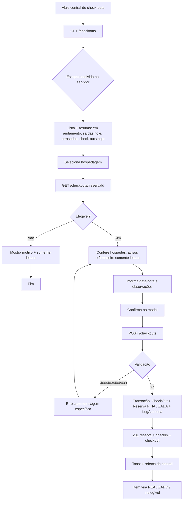

# Fluxo — Check-out no módulo do Estabelecimento

Fluxo operacional do check-out: **central de saídas → seleção da hospedagem → conferência → confirmação
→ encerramento + auditoria**. Contrato de API: [`docs/api/checkout.md`](../api/checkout.md). Plano:
[`Implementations/ImplementationPlan_CheckoutEstabelecimento_20112026.md`](../../Implementations/ImplementationPlan_CheckoutEstabelecimento_20112026.md).
Decisão de modelagem: [`ADR-002`](../adr/ADR-002-checkout-encerramento-hospedagem.md).

> **Estado:** fluxo **entregue** em 20/11/2026 (backend + frontend, `npm run build` exit 0 em ambos,
> 8 suites / 228 testes PASS). O `POST` não foi exercitado contra o banco real (grava) — P-10 do plano.
> Este documento descreve o comportamento implementado; contrato navegável em
> [`docs/api/checkout.md`](../api/checkout.md).

## Atores e pré-condições

| Item | Definição |
|---|---|
| Quem executa | usuário `ESTABELECIMENTO` (dono ou sub-usuário vinculado) ou `ADMIN` |
| Reserva | existe, pertence ao estabelecimento do usuário (checado no servidor) e **já teve check-in** |
| Momento | qualquer dia: antes do previsto (saída antecipada), no dia, ou depois (saída após o previsto) |
| Situação inicial esperada | `CheckIn` existe e `CheckOut` **não** existe |
| Situação final | passa a existir `CheckOut`; `Reserva.status = FINALIZADA`; `LogAuditoria` `CHECKOUT_REALIZADO` |
| Financeiro | **não muda** — `Pagamento` fica intacto; o resumo financeiro é apenas informativo |

## Fluxo em passos

### Passo 1 — Central de saídas (`/estabelecimento/checkout`)

1. A página abre e chama `GET /api/checkouts` (default: `situacao=TODOS`, `page=1`, `limit=20`).
2. O servidor resolve o **escopo do estabelecimento no banco** (dono/sub-usuário/ADMIN) — a query não
   decide escopo; `estabelecimentoId` alheio → `403`.
3. Cabeçalho mostra os 4 números de `resumo`: **em andamento**, **saídas hoje**, **atrasados**,
   **check-outs hoje**.
4. A lista mostra, por hospedagem: código, hóspede, quarto, entrada → saída, chip de situação
   (`HOSPEDADO`/`SAIDA_HOJE`/`ATRASADO`/`REALIZADO`), valor e ação.
5. Filtros: `situacao` (abas), `data` (date picker), `busca` (código/hóspede/quarto), paginação.
   `data` filtra por **saída prevista** ou por **check-out realizado** naquele dia, e tem **precedência**
   sobre `de`/`ate` (enviados juntos, `de`/`ate` são ignorados — contrato, D-16).
6. **Recorte:** a central só lista hospedagem **iniciada** (com check-in) ou já encerrada. Reserva sem
   check-in **não** aparece aqui — ela é tratada na central de check-in.
7. **Abas se sobrepõem por desenho:** `EM_ANDAMENTO` é toda hospedagem iniciada e não encerrada, então
   **inclui** as de `SAIDAS_HOJE` e as de `ATRASADOS`. O operador não pode "esconder" o hóspede que tem de
   tirar hoje; o chip (`SAIDA_HOJE`/`ATRASADO`) é que sinaliza a urgência. O `resumo` espelha essa
   hierarquia (`emAndamento ⊇ saidasHoje + atrasados`), igual ao check-in (`chegadasHoje ⊂ pendentes`).

**Resultado:** o operador vê quem está no quarto, quem sai hoje e quem já saiu.

### Passo 2 — Seleção

7. O operador clica na hospedagem (ou em "Fazer check-out").
8. Itens `REALIZADO` continuam clicáveis (consulta), mas sem ação de encerramento; itens inelegíveis
   mostram `motivoInelegibilidade` + `codigoInelegibilidade` e não habilitam a ação.

**Resultado:** a reserva escolhida vira o contexto da conferência (`reservaId`).

### Passo 3 — Conferência da hospedagem

9. A UI chama `GET /api/checkouts/:reservaId`.
10. Exibe: dados da reserva e do quarto (com `tipoAcomodacao`), perfil do hóspede, **hóspedes do check-in**
    (principal + acompanhantes, com `presente`), resumo financeiro **somente leitura**
    (`valorTotal`, `valorPago`, `saldoEmAberto`, `pagamento`) e a **próxima entrada** no mesmo quarto.
11. Avisos aparecem em **ordem fixa**: `PAGAMENTO_PENDENTE`, `SALDO_EM_ABERTO`, `SAIDA_ANTECIPADA`,
    `SAIDA_APOS_PREVISTO`. Nenhum deles desabilita o botão — são informação, não portão.
    **Gate de estadia iniciada:** sem `CheckIn` não há aviso de antecipação nem de posterioridade (a
    reserva é inelegível por `CHECKIN_NAO_REALIZADO`); os dois avisos financeiros são incondicionais
    (`checkouts.service.ts:783-822`).
12. O formulário pede apenas: **data/hora do check-out** (pré-preenchida com agora, editável) e
    **observações** (≤ 1000). Não há campo financeiro editável.
13. Se já existe `CheckOut` ou a reserva é inelegível, a UI mostra somente leitura + motivo; o botão de
    confirmar não aparece.

**Resultado:** o operador confere quem sai, quem estava hospedado e o que ficou pendente no financeiro.

### Passo 4 — Confirmação

14. Operador clica em **Confirmar check-out**. A UI pede confirmação explícita (modal) resumindo: reserva,
    hóspede principal, data/hora da saída, avisos pendentes e a frase de consequência — "a reserva será
    marcada como **FINALIZADA**; o quarto **não** é liberado antes da data prevista".
15. A UI valida no cliente (formato da data, não futura, não anterior ao check-in, observações ≤ 1000) —
    espelho do DTO; o servidor continua sendo a autoridade (`400` se algo escapar).
16. Envia `POST /api/checkouts` com `reservaId`, `realizadoEm?`, `observacoes?`.
17. Durante o envio: botão em loading, sem duplo submit (proteção de UI + `@unique` no banco).

**Resultado:** requisição única, sem duplicidade.

### Passo 5 — Encerramento e auditoria (servidor, transacional)

18. Validação em ordem determinística: DTO → reserva existe (`404`) → posse (`403`) → `CANCELADA` (`400`)
    → **sem check-in** (`400`) → já tem check-out (`409`) → `realizadoEm` futura (`400`) → anterior ao
    check-in (`400`).
19. Abre `prisma.$transaction`:
    1. rechecagem de duplicidade (`CheckOut.findUnique` por `reservaId`) → `409` se existir;
    2. cria `CheckOut` (`realizadoEm` = enviado ou agora, `responsavelId` = usuário autenticado,
       `observacoes`);
    3. atualiza `Reserva.status` para `FINALIZADA` **só se ainda não for** — nenhum outro campo é tocado;
    4. grava `LogAuditoria` (`acao = 'CHECKOUT_REALIZADO'`, `entidade = 'Reserva'`, `entidadeId = reservaId`,
       `usuarioId` = autenticado, `enderecoIp`, `dadosNovos` = resumo do check-out).
20. Commit. Se qualquer passo falhar, **nada** é gravado (rollback). Corrida de duplo `POST`: `P2002` em
    `CheckOut.reserva_id` → `409` (sem `500`).
21. Resposta `201` com `{ reserva, checkin, checkout }`.

**Resultado:** hospedagem encerrada com autoria, horário, observações e rastro de auditoria — sem nenhuma
movimentação financeira.

### Passo 6 — Pós-registro (UI)

22. Toast de sucesso com o horário do check-out.
23. Fecha o dialog e recarrega `GET /api/checkouts`: o item passa a `situacaoCheckout = REALIZADO`,
    `elegivel = false`, `motivoInelegibilidade = "Check-out já realizado para esta reserva"`,
    `codigoInelegibilidade = "CHECKOUT_JA_REALIZADO"`; os contadores de `resumo`
    (`realizadosHoje`, `saidasHoje`, `emAndamento`, `atrasados`) são atualizados.
24. A reserva sai da aba `EM_ANDAMENTO`/`SAIDAS_HOJE`/`ATRASADOS` e passa a aparecer em `REALIZADOS`.
25. Em `EstReservations`, a reserva agora tem `status = FINALIZADA` (concluída). **Atenção:** esse status
    também aparece para reservas pagas no Mercado Pago **antes** da estadia — "finalizada" não é prova de
    que o hóspede saiu; a prova é o `CheckOut`.
26. `PATCH /reservas/:id/finalize` deixa de funcionar para essa reserva (o service só aceita
    `CONFIRMADA`/`AGUARDANDO_PAGAMENTO`, `reservas.service.ts:289-299`) — o encerramento já foi feito.

**Resultado:** operação encerrada e visível para toda a equipe do estabelecimento.

## Diagrama textual

```
┌──────────────────────────────────────────────────────────────────────────────┐
│  OPERADOR (ESTABELECIMENTO / ADMIN)                                          │
└───────────────┬──────────────────────────────────────────────────────────────┘
                │ 1. abre /estabelecimento/checkout
                ▼
      ┌─────────────────────┐        GET /api/checkouts
      │ CENTRAL DE SAÍDAS   │ ──────────────────────────────────────────────┐
      │ - resumo (4 cards)  │                                               │
      │ - abas + busca      │ ◄────────── escopo resolvido no servidor ◄────┘
      │ - lista paginada    │             (dono | sub-usuário | ADMIN)
      └─────────┬───────────┘
                │ 2. seleciona hospedagem (HOSPEDADO/SAIDA_HOJE/ATRASADO)
                ▼
      ┌─────────────────────┐        GET /api/checkouts/:reservaId
      │ CONFERÊNCIA         │ ──────────────────────────────────────────────┐
      │ - reserva + quarto  │                                               │
      │ - hóspedes do       │ ◄──── avisos: PAGAMENTO_PENDENTE,             │
      │   check-in          │         SALDO_EM_ABERTO,                      │
      │ - financeiro (leitura)│        SAIDA_ANTECIPADA/APOS_PREVISTO        │
      │ - próxima entrada   │ ◄─────────────────────────────────────────────┘
      └─────────┬───────────┘
                │ 3. conferência + 4. confirmação no modal
                ▼
      ┌─────────────────────┐        POST /api/checkouts
      │ CONFIRMAR CHECK-OUT │ ──────────────────────────────────────────────┐
      └─────────┬───────────┘                                               │
                │                                                           ▼
                │                                        ┌──────────────────────────────┐
                │                                        │ SERVIDOR (transação única)   │
                │                                        │ 1) valida elegibilidade      │
                │                                        │ 2) recheca duplicidade       │
                │                                        │ 3) INSERT CheckOut           │
                │                                        │ 4) UPDATE Reserva=FINALIZADA │
                │                                        │ 5) LogAuditoria              │
                │                                        │ (nada de Pagamento)          │
                │                                        └──────────────┬───────────────┘
                │                                                       │ 201 {reserva,checkin,checkout}
                ▼ ◄─────────────────────────────────────────────────────┘
      ┌─────────────────────┐
      │ PÓS-REGISTRO        │  toast + refetch da central
      │ item = REALIZADO    │  reserva.status = FINALIZADA
      │ inelegível p/ novo  │  auditoria gravada
      └─────────────────────┘
```

## Diagrama de estados (derivados, por reserva)

```
                        ┌──────────────────────────────────────────┐
                        │  Reserva.status (comercial, 5 valores)   │
                        │  SOLICITADA → CONFIRMADA → AGUARDANDO_   │
                        │  PAGAMENTO → FINALIZADA | CANCELADA      │
                        │  (FINALIZADA também = pago no MP,        │
                        │   ANTES da estadia)                      │
                        └──────────────────┬───────────────────────┘
                                           │ (eixo independente)
                                           ▼
     sem CheckIn ─────────────────────────► fora da central
                                            detalhe: CHECKIN_NAO_REALIZADO (POST 400)

     com CheckIn,
     sem CheckOut ─┬── checkOut previsto > hoje ──► HOSPEDADO  (elegível)
                   ├── checkOut previsto = hoje ──► SAIDA_HOJE (elegível)
                   └── checkOut previsto < hoje ──► ATRASADO   (elegível, aviso SAIDA_APOS_PREVISTO)

     com CheckOut ────────────────────────────────► REALIZADO  (inelegível: CHECKOUT_JA_REALIZADO, POST 409)

     inelegibilidade independente de data/check-out:
       CANCELADA ► RESERVA_CANCELADA
```

Cada inelegibilidade aparece em dois campos: `motivoInelegibilidade` (texto pt-BR para a UI) e
`codigoInelegibilidade` (código estável da tabela acima).

Mermaid equivalente (renderiza no GitHub):



## Sequência da transação (detalhe)

```
POST /api/checkouts
  │
  ├─ 1. SELECT reserva (hospede + perfil + quarto + tipoAcomodacao + estabelecimento + pagamento + checkin + checkout)
  │     └─ 404 se não existe; 403 se estabelecimento fora do escopo
  ├─ 2. status CANCELADA?  ───────────────────────────────► 400 RESERVA_CANCELADA
  ├─ 3. tem CheckIn?  ──── não ──────────────────────────► 400 CHECKIN_NAO_REALIZADO
  ├─ 4. já tem CheckOut?  ───────────────────────────────► 409 CHECKOUT_JA_REALIZADO
  ├─ 5. realizadoEm futura (> agora + 5 min)?  ──────────► 400
  ├─ 6. realizadoEm < checkin.realizadoEm?  ─────────────► 400
  │
  └─ 7. BEGIN
        ├─ rechecagem: já existe CheckOut? ──────────────► 409
        ├─ INSERT CheckOut (reserva_id UNIQUE, realizado_em, responsavel_id, observacoes)
        ├─ UPDATE Reserva SET status = 'FINALIZADA'  (somente se status <> 'FINALIZADA')
        └─ INSERT LogAuditoria (CHECKOUT_REALIZADO, Reserva, reservaId, usuarioId, enderecoIp, dadosNovos)
     COMMIT
        └─ P2002 em reserva_id ⇒ ROLLBACK + 409
     (nenhum UPDATE/INSERT em "Pagamento")
```

## Erros no fluxo e o que a UI faz

| Erro | Origem | Comportamento |
|---|---|---|
| `400` DTO | validação do body | marcar campos inválidos no formulário |
| `404` | reserva sumiu/foi removida | fechar dialog, toast e refetch da central |
| `403` | reserva de outro estabelecimento (`GET`/`POST`) ou `estabelecimentoId` fora do escopo | toast de erro, sem retry automático |
| `409` | alguém já fez o check-out (outra aba/colega) | toast "check-out já realizado", refetch e abrir o detalhe em leitura |
| `400` cancelada / sem check-in | reserva ficou inelegível entre o `GET` e o `POST` | toast com a mensagem do servidor, refetch; se for "sem check-in", oferecer o atalho para o check-in |
| `400` data inválida | data/hora do check-out fora das regras | destacar o campo de data |
| `401` | sessão expirada | fluxo global de refresh do `api.ts`; se falhar, volta ao login |
| *(sem erro)* | `ESTABELECIMENTO` sem vínculo | `200` com lista vazia e `resumo` zerado |

## O que **não** está neste fluxo

- **Cobrança, baixa ou estorno** de pagamento — o financeiro é somente leitura (ADR-002, D-6).
- **Liberar o quarto / noites restantes** na saída antecipada: a disponibilidade continua bloqueando
  `FINALIZADA` (`quartos.service.ts:80-82`) — **R-40**, pendência de decisão de produto (P-1).
- **Status de quarto/limpeza/manutenção**: o modelo não tem esse eixo (`schema.prisma:193-215`) e o
  check-out não o cria. `acomodacao.proximaEntrada` é agenda, não estado.
- **Consumo/minibar/extras**: não existe módulo no projeto.
- **Reabrir ou cancelar um check-out** (`PATCH`/`DELETE /checkouts/:reservaId`).
- **No-show automático**: reserva sem check-in não entra na central; o detalhe explica
  `CHECKIN_NAO_REALIZADO`.
- **Notificação ao hóspede**, assinatura digital, QR code.
- **`PATCH /reservas/:id/finalize`**: continua existindo como caminho paralelo de encerramento, **sem**
  checagem de dono (**R-08**, aberto) e **sem** gerar `CheckOut`; o check-out não o utiliza.
